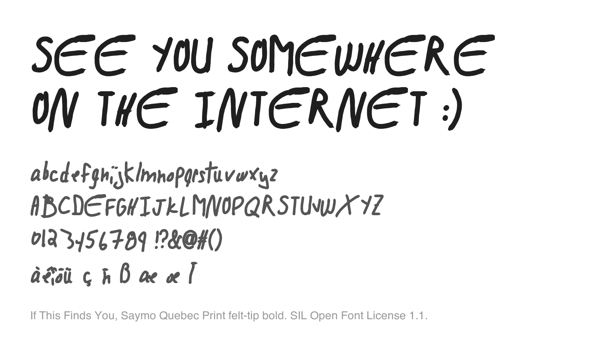

# IfThisFindsYou Saymo quebec-print-felt-bold GY3E

A bold felt-tip handwriting font: the **Saymo Quebec Print, felt-tip bold** hand from
[If This Finds You](https://ifthisfindsyou.app), which writes fictional writers' hands from real
handwriting traditions. It's free to use, including commercially, under the
[SIL Open Font License 1.1](https://openfontlicense.org).



That is the font's original name, as it's written inside the file. It has upper and lower case,
figures, punctuation and accented Latin letters (319 characters).

## Files

| File | For |
|---|---|
| `fonts/IfThisFindsYou-Saymo-quebec-print-felt-bold-GY3E.woff2` | Websites |
| `fonts/IfThisFindsYou-Saymo-quebec-print-felt-bold-GY3E.ttf` | Installing on a computer (Figma, Keynote, Word and the like). It's the same font as the WOFF2, unpacked; the outlines and names are unchanged. |
| `LICENSE.txt` | The SIL Open Font License 1.1, with the font's copyright notice |
| `CREDITS.txt` | Every source the hand was built from |

## Use it on a website

```css
@font-face {
  font-family: "IfThisFindsYou Saymo quebec-print-felt-bold GY3E";
  src: url("/fonts/IfThisFindsYou-Saymo-quebec-print-felt-bold-GY3E.woff2") format("woff2");
  font-weight: 400;
  font-display: swap;
}

h1 {
  font-family: "IfThisFindsYou Saymo quebec-print-felt-bold GY3E", "Bradley Hand", cursive;
}
```

It reads best in capitals at display sizes (`text-transform: uppercase`).

## Credits

- **The font:** The If This Finds You Project Authors, [ifthisfindsyou.app](https://ifthisfindsyou.app).
- **The handwriting it was traced from:** volunteers' handwritten copies made for **Copiste d'un
  jour**, a project of the Bibliothèque et Archives nationales du Québec (2024), published under
  [CC BY 4.0](https://creativecommons.org/licenses/by/4.0/). Letter skeletons were traced from the
  photographs, then redrawn, varied and outlined by a generator. No endorsement by the writers or
  the project is implied.
- **The Hershey fonts:** some symbols, punctuation and letter skeletons derive from them, and their
  terms ask that this acknowledgement travels with the data: *The Hershey Fonts were originally
  created by Dr. A. V. Hershey while working at the U. S. National Bureau of Standards. The format
  of the Font data in this distribution was originally created by James Hurt, Cognition, Inc., 900
  Technology Park Drive, Billerica, MA 01821 (mit-eddie!ci-dandelion!hurt).*

Every source page is listed by name and link in [`CREDITS.txt`](CREDITS.txt).

## If you share it on

- Keep `LICENSE.txt` and `CREDITS.txt` with the font files.
- You can bundle it with anything (a site, an app, a template, a product), but you can't sell the
  font on its own.
- If you change the font itself, give your version a different name.

Shared by [Rajat Sethi](https://x.com/sethihq). All credit for the font goes to the people above.
